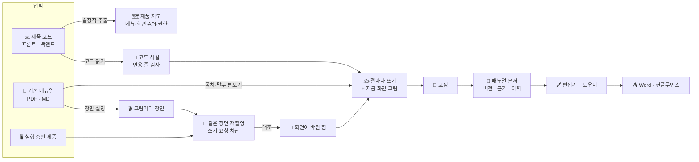
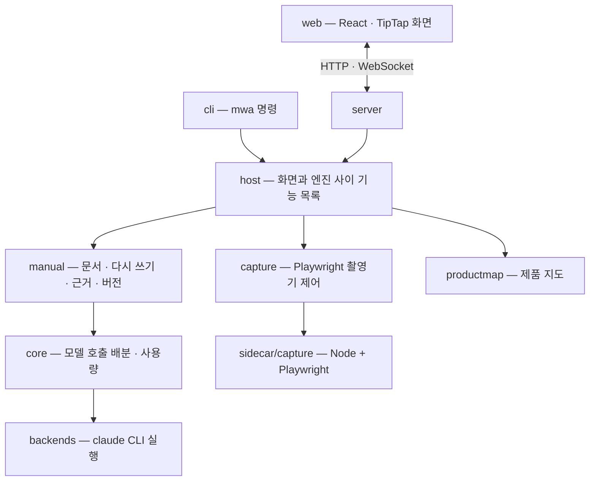

<div align="center">

# 📘 mwa — Manual Write Anything

**코드와 실제 화면을 읽고, 매뉴얼을 쓰고, 제품이 바뀌면 따라 고칩니다.**

웹 제품의 한국어 사용자 매뉴얼을 만들고 계속 최신으로 유지하는 도구


[하는 일](#-하는-일) · [어떻게 동작하나](#-어떻게-동작하나) · [빠른 시작](#-빠른-시작) · [화면 사용법](#️-화면-사용법) · [명령줄](#️-명령줄) · [안전 원칙](#️-안전-원칙)

</div>

---

## 🤔 왜 만들었나

매뉴얼은 쓰는 순간부터 낡기 시작합니다. 버튼 이름이 바뀌고, 컬럼이 생기고, 입력 칸이 읽기 전용이 되어도 매뉴얼은 그대로 남습니다. 그림을 다시 찍고 문장을 고치는 일은 늘 뒤로 밀립니다.

**mwa는 그 일을 대신합니다.** 예전 매뉴얼을 본보기로 삼아 **지금 코드**에서 사실을 뽑고, **지금 화면**을 같은 구도로 다시 찍고, 둘을 근거로 매뉴얼을 다시 씁니다. 사람은 결과를 편집기에서 확인하고 다듬기만 하면 됩니다.

## ✨ 하는 일

| | 일 | 설명 |
|:-:|---|---|
| 🔄 | **기존 매뉴얼 갱신** | 예전 PDF·Markdown 매뉴얼을 가져와 그림마다 **같은 장면을 지금 화면으로 다시 찍고**(같은 영역·같은 비율), 화면이 바뀐 점을 찾아 글에 반영합니다. 목차·표·말투는 기존 매뉴얼을 따릅니다 |
| ✍️ | **새 매뉴얼 쓰기** | 매뉴얼이 없는 기능은 이미 만든 매뉴얼을 본보기로 목차를 정하고, 절마다 코드 사실로 쓰고, **그림 자리를 정해 자동으로 찍은 뒤** 찍은 그림을 보고 글을 보완합니다 |
| 🕰️ | **버전 관리** | 저장할 때마다 버전이 남습니다. 기존 매뉴얼이나 이전 버전과 **나란히 비교**하고 되돌릴 수 있습니다 |
| 🔍 | **근거 추적** | 문단마다 **"왜 이렇게 썼나"**(어떤 코드 사실, 어떤 화면)와 **"어디서 왔나"**(기존 몇 쪽, 누가 언제 고쳤나)가 남습니다 |
| 🧹 | **사용자 관점 교정** | 다 쓴 뒤 독자 입장에서 한 번 더 읽고 내부 구현(서버·API·세션 등), 잘린 메시지, 중복을 걸러 냅니다 |
| 📤 | **내보내기** | Word(.docx) 내보내기, 그리고 확장 기능으로 **컨플루언스 Cloud 게시**(패널·상태 라벨·그림 그대로) |

## 🧭 어떻게 동작하나



- **사실은 코드에서, 글은 사실로.** 메뉴·화면·API·권한은 LLM 없이 코드에서 뽑고, 기능 동작은 코드 조각에서 사실로 뽑아 인용한 줄이 실제로 있는지 검사합니다.
- **그림은 지금 화면으로.** 예전 그림과 같은 장면을 Playwright로 다시 찍고, 예전 그림과 대조해 화면 자체가 바뀐 점(컬럼 추가, 읽기 전용 전환, 문구 변경)을 데이터 값 차이와 따로 기록합니다.
- **LLM은 정해진 역할만.** 조율은 Rust가 하고, 모델은 사실 추출·쓰기·촬영 계획·판정 같은 한 번짜리 판단에만 들어갑니다.

## 🚀 빠른 시작

### 준비물

서버 한 대에만 있으면 됩니다. `install.sh`가 확인하고, 없는 것은 설치하거나 설치 방법을 알려 줍니다.

| 무엇 | 왜 | 설치 |
|---|---|---|
| Rust (stable) | 엔진 빌드 | <https://rustup.rs> |
| Node.js 20+ | 화면 빌드, 화면 촬영 | <https://nodejs.org> |
| Claude Code CLI | 글쓰기·판단 (구독 로그인) | `npm i -g @anthropic-ai/claude-code` 후 `claude`로 로그인 |
| poppler | 기존 매뉴얼 PDF 읽기 | macOS `brew install poppler` · Ubuntu `apt install poppler-utils` |

> 💡 LLM은 API 키가 아니라 **구독으로 로그인된 공식 CLI**를 하위 프로세스로 실행해서 씁니다. 화면에 보이는 금액은 정가로 바꿔 본 값입니다.

### 설치 — 서버에 한 번

```sh
git clone https://github.com/now1256/manual-write-anything.git
cd manual-write-anything
./install.sh
```

`install.sh`가 하는 일:
1. 준비물 확인 — 없으면 Rust와 Claude CLI는 설치하고, Node·poppler는 설치 방법을 알려 줍니다. Claude 로그인이 안 돼 있으면 지금 할지 묻습니다
2. 화면과 엔진을 빌드해 `~/.cargo/bin/mwa`로 설치합니다 (엔진·화면·촬영 스크립트가 파일 하나에)
3. 포트(기본 7000)를 묻고, 프로젝트 폴더(`~/manuals/project`, 화면에서 바꿀 수 있음)와 촬영 브라우저(Playwright + Chromium)를 준비합니다
4. 원하면 systemd 서비스로 등록해 서버가 켜질 때 자동으로 띄웁니다
5. 접속 주소를 알려 줍니다

Claude **구독 로그인**은 설치 중에 바로 하거나, 나중에 이 서버에서 `claude auth login`으로 합니다. 모든 사용자의 작업이 이 계정으로 돌아갑니다.

### 접속 — 사내망 누구나

```
http://<서버 IP>:7000
```

브라우저로 위 주소에 들어가면 끝입니다. 쓰는 사람은 아무것도 설치하지 않습니다. 서비스로 등록하지 않았다면 직접 띄웁니다.

```sh
mwa -C ~/manuals/acme serve     # 기본 0.0.0.0:7000 · 빈 폴더면 프로젝트를 만듭니다
```

화면의 **시작하기**가 남은 단계를 하나씩 안내합니다. 단계를 누르면 그 단계의 설정만 열리고, 저장하면 다음 단계로 넘어갑니다.

1. **코드 연결** — 프론트·백엔드 코드 위치 (폴더 또는 Git 주소)
2. **Claude 로그인** — 이 서버에서 `claude auth login`을 했는지 확인합니다
3. **코드 읽고 제품 파악** — 버튼 하나로 Claude가 코드를 읽고 제품 어댑터(메뉴 파일, API 호출 방식, 권한, 로그인 방식)를 만든 뒤, 제품 지도를 만들어 바로 확인합니다. 어댑터 형식을 몰라도 됩니다
4. **사이트와 계정** — 촬영할 사이트 주소와 계정
5. **첫 화면 촬영 · 첫 매뉴얼**

> ⚠️ 접속 비밀번호가 없습니다. **사내망 안에서만** 여세요. 주소창에 IP로 들어온 요청과 이 화면 자신이 보낸 요청만 받아서, 다른 웹사이트가 몰래 요청을 보내는 것은 막습니다.

### 서버 운영

| 하고 싶은 일 | 명령 |
|---|---|
| 상태 보기 | `systemctl --user status mwa` (root로 설치했으면 `--user` 없이) |
| 다시 띄우기 | `systemctl --user restart mwa` |
| 로그 보기 | `journalctl --user -u mwa -f` |
| 새 버전으로 업데이트 | `git pull && ./install.sh` |
| 방화벽 열기 (Ubuntu) | `sudo ufw allow 7000/tcp` |

## 🖥️ 화면 사용법

첫 화면은 **매뉴얼 현황판**입니다. 기능마다 기존 매뉴얼·그림·문서 버전·근거·코드 변경 여부와 **다음 할 일**이 보이고, 줄을 누르면 그 기능이 열립니다.

기능 하나는 네 단계로 다룹니다.

```
 ① 기존 매뉴얼  ─▶  ② 그림 고르기  ─▶  ③ 매뉴얼 만들기  ─▶  ④ 편집·버전
```

<table>
<tr><td width="170"><b>① 기존 매뉴얼</b></td><td>

PDF·MD를 올리거나 고릅니다. **"장면 설명 만들기"**로 그림마다 어떤 화면·상태인지 읽어 둡니다.
기존 매뉴얼 없이 시작하려면 **연결 해제**. 단계별 모델 구성도 여기서 바꿉니다.

</td></tr>
<tr><td><b>② 그림 고르기</b></td><td>

기존 그림과 **같은 장면을 지금 화면으로** 찍습니다. 장면마다 판정(재현 ✓ / 다름 △ / 못 찍음 ✗)과
**화면이 바뀐 점**이 나오고, 쓸 그림을 고릅니다: 자동 · 지금 화면 · 기존 그림 · 직접 올린 그림.
못 찍은 장면은 "어디서 막혔는지" 단계별 기록이 남습니다.

</td></tr>
<tr><td><b>③ 매뉴얼 만들기</b></td><td>

**코드 읽기**(사실 추출, 1~2분) → **매뉴얼 쓰기**.
기존 매뉴얼이 있으면 목차·말투를 따르고 지금 화면 그림을 보며 다시 쓰고,
없으면(또는 **처음부터 새로 만들기**) 다른 매뉴얼을 본보기로 쓰고 그림 자리를 바로 찍습니다.
제품이 바뀌면 **"제안 받기"**로 바뀐 곳만 고칠 수도 있습니다.

</td></tr>
<tr><td><b>④ 편집·버전</b></td><td>

컨플루언스식 편집기: <code>/</code> 메뉴, 표·패널·상태 라벨, 그림 크기 조절·다시 찍기.
오른쪽 **도우미**에 말로 요청하면 문서 전체를 보고 고칠 곳을 찾아 미리 보여 줍니다.
문단 옆 <b>?</b>에서 근거, <b>기록</b>에서 버전별로 바꾼 이유, 버전을 나란히 비교·되돌리기.
"확인 필요" 메모와 못 찍은 그림 자리는 편집기에만 보이고 내보내기에서는 빠집니다.

</td></tr>
</table>

그 밖의 탭: **개요** · **화면·API** · **권한** · **코드 사실**(뽑힌 사실을 파일 위치·코드 원문과 함께 검색)

## ⏰ 자동 작업

첫 화면의 매뉴얼 현황 아래에서 규칙을 문장처럼 만듭니다.

> **매일 09:00에** · **코드가 바뀐 기능**만 · **코드 다시 읽고 바뀐 곳 제안** · ☑ 그림도 다시 찍기 → **검토 대기까지**

| 고르는 것 | 선택지 |
|---|---|
| 언제 | 매일 시각 · 매주 요일과 시각 · 몇 시간마다 |
| 어떤 기능 | 코드가 바뀐 기능 (그 기능의 코드 사실이 인용한 파일이나 화면 파일이 바뀐 것만) · 고른 메뉴 |
| 무엇을 | 코드 다시 읽고 바뀐 곳 제안 · 코드로 매뉴얼 다시 쓰기 · 그림도 다시 찍기 |
| 어디까지 | 검토 대기 (사람이 ④에서 확인) · 수락하고 컨플루언스 게시 |

서버(`mwa serve`)가 떠 있는 동안 1분마다 확인해 돌고, **지금 실행**으로 바로 돌릴 수도 있습니다. 결과는 실행 기록에 남습니다.

## ⌨️ 명령줄

화면에서 하는 일은 모두 명령으로도 됩니다 (`mwa --help`).

| 명령 | 하는 일 |
|---|---|
| `mwa doctor` | 설치·로그인·소스 점검 |
| `mwa adapter` | 코드를 읽고 제품 어댑터 만들기 (+ 제품 지도) |
| `mwa map` | 제품 지도 |
| `mwa ref import <파일·폴더>` | 기존 매뉴얼 가져오기 (PDF·MD) |
| `mwa ref describe <문서 id>` | 그림마다 장면 설명 |
| `mwa shot ref --only <기능>` | 기존 매뉴얼 장면 다시 찍기 (`--scene <그림>`: 하나만) |
| `mwa gen <기능>` | 코드 읽기 (사실 추출) |
| `mwa doc write <기능>` | 매뉴얼 쓰기 (`--fresh`: 기존 매뉴얼 없이 처음부터) |
| `mwa shot doc --only <기능>` | 그림 자리 찍기 (`--scene <블록 id,…>`: 일부만) |
| `mwa doc update <기능>` | 코드 기준 갱신 제안 |
| `mwa serve` | 화면 (기본 `0.0.0.0:7000`, `--addr`로 바꿈) |
| `mwa browser` | 촬영용 브라우저 설치 |

모든 명령은 `mwa -C <프로젝트 폴더> …` 형태로 씁니다.

## 💸 비용 감 잡기

한 기능(표 7개, 그림 10여 장 규모) 기준, 정가 환산 값입니다. 구독 안에서 쓰면 실제 청구는 없습니다.

| 작업 | 시간 | 정가 환산 |
|---|---|---|
| 코드 읽기 | 약 1분 | ≈ $0.02 |
| 기존 매뉴얼 옮기기 (10쪽) | 1~2분 | ≈ $0.01 |
| 기존 매뉴얼 기준 다시 쓰기 (그림 포함) | 3~5분 | ≈ $0.25–0.40 |
| 처음부터 새로 만들기 (촬영·보완 포함) | 5~8분 | ≈ $0.80 |
| 장면 촬영 (그림당) | 수 초 | ≈ $0.01 |

## 📁 프로젝트 폴더

```
<프로젝트>/
├─ mwa.toml              설정 (비밀값 없음) — 코드 위치, 사이트, 역할별 모델, 확장 기능
├─ adapter.toml          제품 규칙 — 메뉴 파일, 권한 정의, 로그인 방식 (docs/adapter.md)
├─ map/                  제품 지도
├─ reference/<문서>/     가져온 기존 매뉴얼 (글, 그림, 쪽 이미지, 장면 설명)
├─ shots/                찍은 화면 (reference/: 기존 장면 재촬영, doc/: 그림 자리)
└─ manual/
   ├─ <기능>.json        코드 사실
   └─ docs/<기능>/       매뉴얼 문서 — doc.json · v<n>.json · provenance.json · grounding.json · assets/
```

## 🧱 구조



자세한 설계는 [docs/architecture.md](docs/architecture.md), 제품 어댑터 형식은 [docs/adapter.md](docs/adapter.md)에 있습니다.

## 🛡️ 안전 원칙

- 🔒 **대상 제품의 코드는 읽기만** 합니다.
- 🚫 **공유 서버에는 쓰지 않습니다.** 로그인·세션 연장 외의 쓰기 요청은 촬영 중 브라우저에서 막습니다.
- 1️⃣ **로그인은 1회만** 시도하고, 실패하면 그 계정의 자동 로그인을 멈춥니다 (계정 잠금 방지).
- 🔑 **비밀번호·토큰은 사용자 PC의 자격 파일**(`~/.config/mwa/credentials.json`, 0600)에만 둡니다. 구독 OAuth 토큰은 읽지 않고 공식 CLI만 실행합니다.
- 📝 **매뉴얼에는 사용자가 보고 하는 일만** 씁니다. 서버의 권한 검사 같은 보안 내부 사항은 쓰지 않습니다.

## 🧩 지원 범위

- 지금은 **Next.js(app router) + FastAPI** 구조의 제품을 지원합니다. 제품마다 다른 규칙은 `adapter.toml`로 줍니다.
- 데스크톱 앱(macOS, 선택): `./app/build-mac.sh` → `app/src-tauri/target/release/bundle/dmg/`
